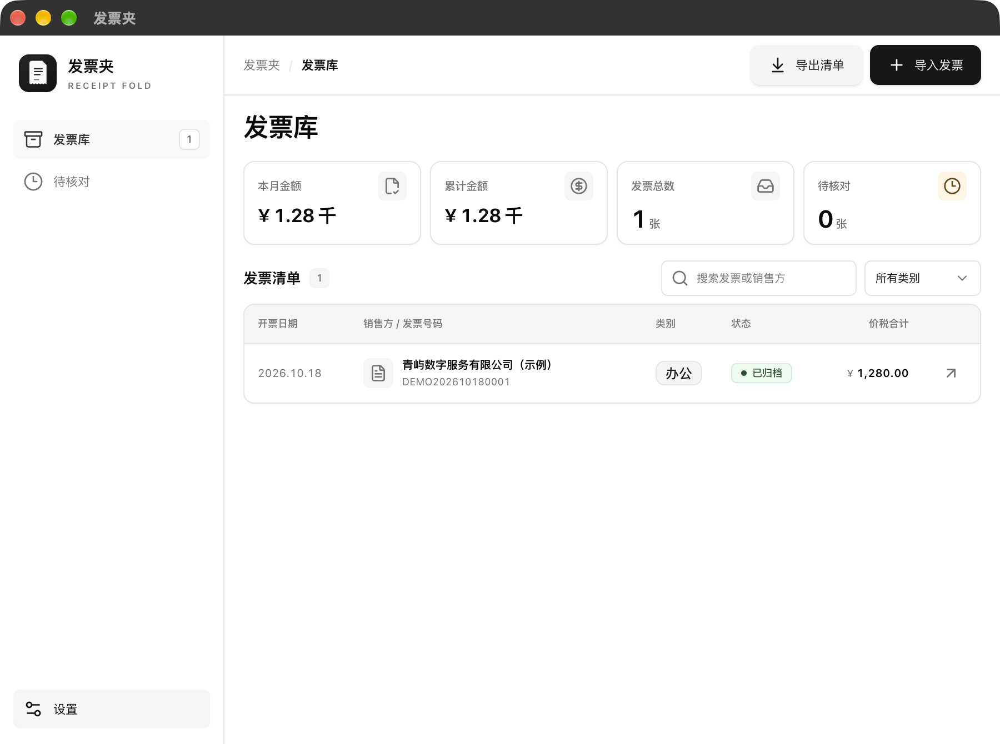
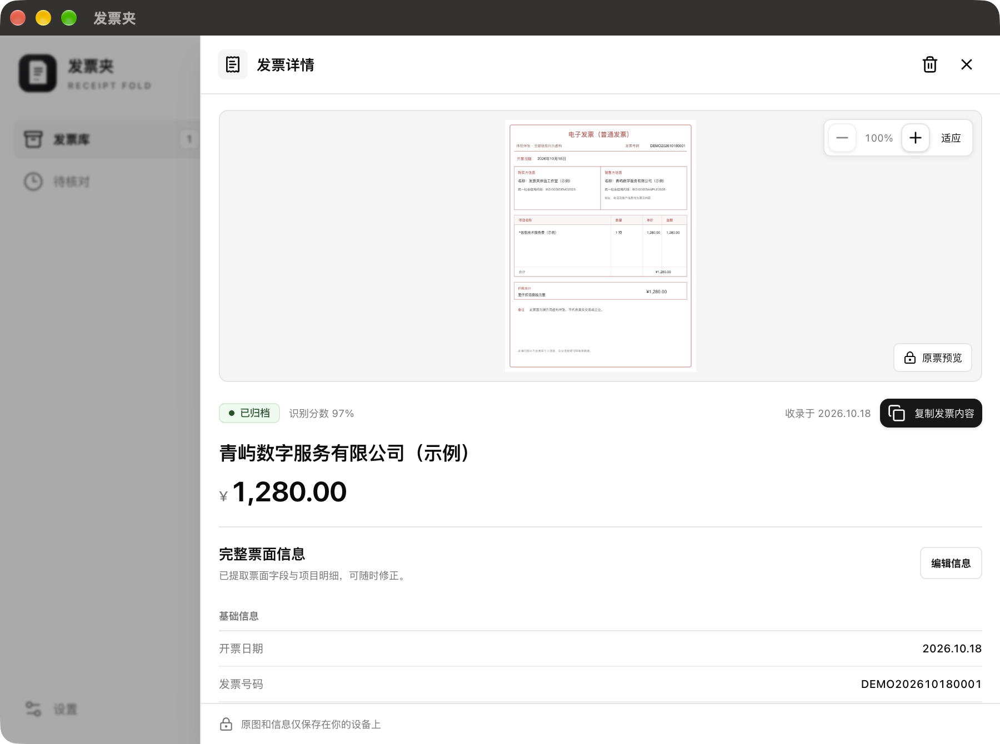

# 发票夹

**把发票收进一个只属于你自己的本地发票库。**

发票夹是一款桌面发票整理工具。导入发票图片后，应用会在本机识别并预填票面信息；你可以核对、修改、搜索和导出发票，不需要注册账号，也不需要把发票交给云端处理。

[下载最新版本](https://github.com/OSpoon/ReceiptFold/releases/latest) · [反馈问题](https://github.com/OSpoon/ReceiptFold/issues)

## 看看发票夹

导入后的发票集中显示在发票库。总览可以查看本月金额、累计金额和待核对数量，也可以按关键词或类别查找发票。



打开一张发票，可以查看原图、放大票面，并核对识别结果。完整票面信息支持编辑；“复制发票内容”会整理成便于粘贴的文本。



截图中的发票、企业、税号和金额均为虚构的演示数据。

## 你可以用它做什么

- **导入发票图片**：点击导入或拖入文件，支持 JPG、PNG、WEBP、BMP 和 TIFF，可一次选择多张。
- **在本机识别**：使用 RapidOCRNode 识别票面文字，并预填发票类型、号码、日期、购销双方、金额和项目明细等字段。
- **核对和修改**：在待核对列表中补全或修正识别结果。信息完整后可归档，也可以随时重新编辑。
- **整理和查找**：按销售方、发票号码或图片名称搜索，按类别筛选；发票库显示本月与累计金额。
- **查看和复制**：在详情中预览、缩放原图，一键复制整理后的发票内容。
- **导出清单**：将票面字段和项目明细导出为 CSV，便于在表格软件中继续整理。

## 隐私与离线使用

发票图片、识别结果和修改内容保存在本机。RapidOCRNode 在本机 CPU 上运行识别，发票内容不会上传到云端。

首次使用 OCR 时需要联网下载所选模型；模型下载完成后，识别可以离线进行。你可以在“设置”中切换轻量、标准或增强规格，并打开本地数据和模型所在文件夹。

## 开始使用

1. 前往[最新版本页面](https://github.com/OSpoon/ReceiptFold/releases/latest)，下载与你的电脑对应的安装包。
2. 安装并打开“发票夹”。首次使用 OCR 时保持联网，以便下载识别模型。
3. 点击“导入发票”，选择图片；识别完成后到“待核对”查看需要补充的信息。

发布页面提供 macOS、Windows 和 Linux 的构建包。若页面还没有版本资产，表示首个安装包尚未发布。

## 开发与构建

需要 Node.js 24 或更高版本。

```sh
npm ci
npm run dev
```

构建应用：

```sh
npm run build:mac
npm run build:win
npm run build:linux
```

项目基于 Electron、Vue 3、TypeScript、electron-vite 和 shadcn-vue 风格组件构建；本地发票数据使用 SQLite 保存，OCR 由 [RapidOCRNode](https://github.com/OSpoon/RapidOCRNode) 提供。

## 许可证

[MIT](LICENSE) © OSpoon
